# Fundamentos da programação de computadores 

## fonte: Fundamentos da programação de computadores_ algoritmos, PASCAL, C_C++ (padrão ANSI) e JAVA 

### Cap 1 - Conceitos básicos

**lingueagem de programação:**  é um método formal com regras de sintaxe e semântica que permite aos humanos darem instruções a um computador para a criação de softwares.

#### 1.1 Conceito de Algoritmo

**Algoritmo** é uma sequência finita de instruções ou operações cuja execução, em tempo finito, resolve
um problema computacional, qualquer que seja sua instância

Ex: Algoritmo - Somar três números 

* Passo 1 — Receber os três números.
* Passo 2 — Somar os três números.
* Passo 3 — Mostrar o resultado obtido.

#### 1.2 Método para a construção de algoritmos 

1) Compreneder o problema 
2) definir os dados de entrada
3) Definir o processamento
4) Definir os dados de saída
5) contruir o algoritmo
6) testar o algoritmo

#### 1.3 Tipos de representação de algoritmos

1) descrição narrativa  -> explicação e detalhamento da resolução do problema.
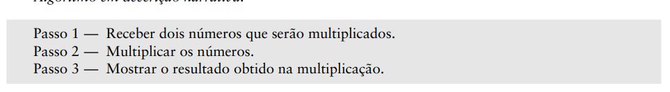
2) fluxograma -> explicação do problema por meio de símbolos gráficos 
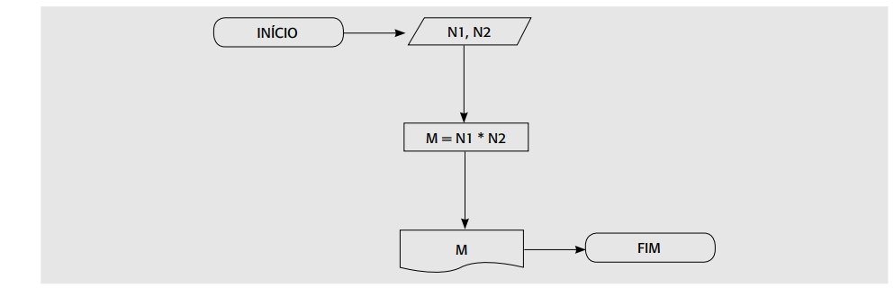
3) pseudócodigo -> detalhamento dos passos do algoritmo escrito em sua linguagem natural
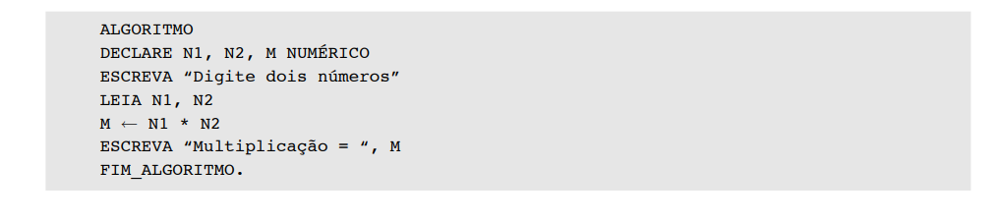

#### 1.4/1.5 Conceito de variável

uma variável é um espaço reservado na memória do computador (física ou virtual) que serve para armazenar, consultar e modificar dados durante a execução de um programa.

#### 1.6 Tipos de Dados 

1) númericos 
2) lógicos
3) caracteres/literais

#### 1.7 Formação de identificadores

identificadors são os nomes das coisas das linguagens iu seja das constantes, variáveis, programas , rotinas, das unidades e etc
As suas regras básicas são:

1) As regras básicas para a formação dos identificadores são:
2) Os caracteres permitidos são: os números, as letras maiúsculas, as letras minúsculas e o caractere
sublinhado.
3) O primeiro caractere deve ser sempre uma letra ou o caractere sublinhado.
4) Não são permitidos espaços em branco e caracteres especiais (@, $, +, –, %, !).
5) Não podemos usar as palavras reservadas nos identificadores, ou seja, palavras que pertençam à
linguagem de programação

exemplo -> idadeMaior


### Cap 2 - Paradigmas de programação

Os paradigmas de programação são estilos, abordagens ou modelos fundamentais que orientam como o programador estrutura e resolve problemas por meio do código. Eles definem a visão e a lógica empregadas para construir um software,

Existem dois grupos principais de paradigmas, **Imperativo ou/e Declarativos.**

#### Imperativos  - como o computador realiza a tarefa 

1) Estruturado/processual  -> quebra os problemas em partes menores chamados de sub-rotinas ou funções focando em organizar o fluxo de controle.
usando um ou mais tipos de estrutura: sequencial, condicional e interativa(de repetição)
2) Orientado a objetos  -> organiza o código em "objetos" que combianm dados (atributos) e comportamentos (métodos ) baseando em pilares como herança, encapsulamento e polimorfismo.

#### Declartivo - o que deve ser feito


1) Funcional: Baseia-se em funções matemáticas puras, imutabilidade de dados (os valores não mudam) e ausência de efeitos colaterais
2) Lógica: Baseia-se em regras formais de lógica matemática e inferências. 
3) Reativo / de Consulta: Focado em fluxos de dados assíncronos e na propagação de mudanças (muito usado em interfaces e reatividade) ou em consultas diretas de dados. (Exemplos: SQL para bancos de dados, RxJS) 


### Cap 3 - Estrutura sequencial

#### 3.1 Estrutua sequencial em algoritmos 
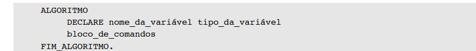

##### 3.1.1 - Declaração de varáveis em algoritmos


##### 3.1.2 Comando de atribuição em algoritmos
usando o símbolo ->  em algoritmos e =  em linguagens 
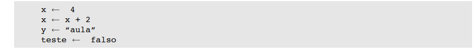

##### 3.1.3 Comando de entrada
Pra receber algoritmos utiliza o equivalente ao comando leia 

##### 3.1.4 Comando de saída 
Pra receber algoritmos utiliza o equivalente ao comando Escreva 

#### 3.4 - Estrutura sequencial em JAVA 

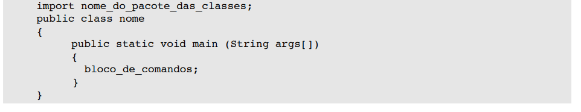

* Os pacotes são métodos(funções) escritos em java
* java é sensivel as letras masiculas e minusculas 

##### 3.4.1 - Declaração de variavéis em JAVA  

Java é uma linguagem de Tipagem estática ou seja, temos que declarar o tipo de dado antes de colocar o nome da 
variável.

* float - reais (32 bits )
* double - rais (64 bits )
* char - 1 caractere 
* string - varios caracteres 
* int - inteiro
* boolean (verdadeiro ou falso)

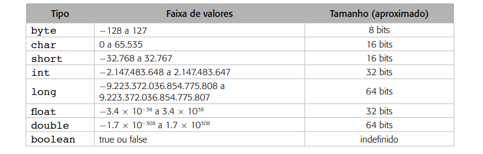

##### 3.5.2 Declaração de constantes em JAVA 
constante é um valor que assim que definido não se pode mudar, em java pode ser colocado em diferentes locais e isso define seu escopo (onde pode usar sem acarretar erro de compilação)
em java se for declarada em um método como o main ficara restrito ao escopo do método (nesse método o escopo e estático por ser o principal), no caso do java se usa  a palavra chave - final e 
static geralmente pra pertencer a classe e economizar mémoria. 

##### 3.4.3 Comando de atribuição em JAVA  (=) 
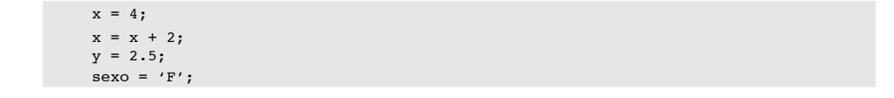


##### 3.4.4 Comando  de entrada em JAVA 
Uma das maneiras de receber os dados dos usuários é por meio da classe Scanner que requer a importação do pacote java útil.
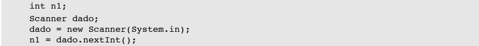

##### 3.4.5 Comando de saída em JAVA 

system.out.print e system.out.println

##### 3.4.5 comentarios em java 

````
// ou /*.......*/
````
##### 3.4.6 Operadores e funções predefinidas em Java 

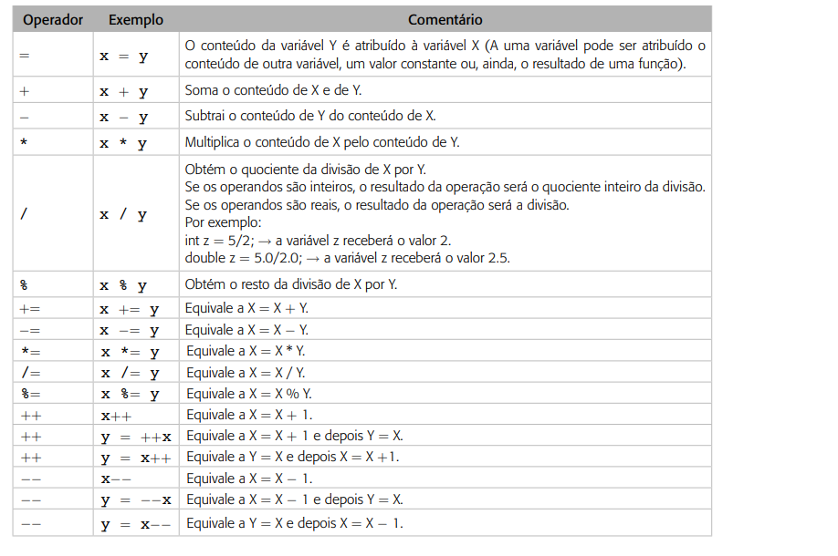

- matematicos 

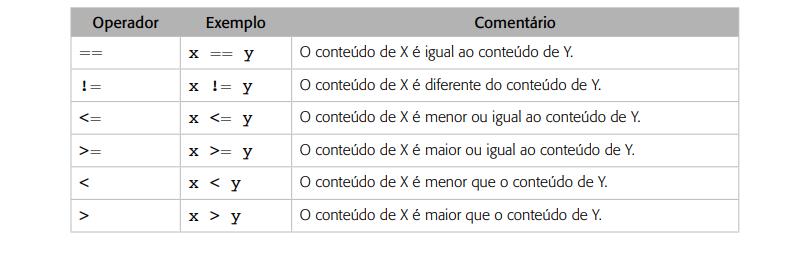
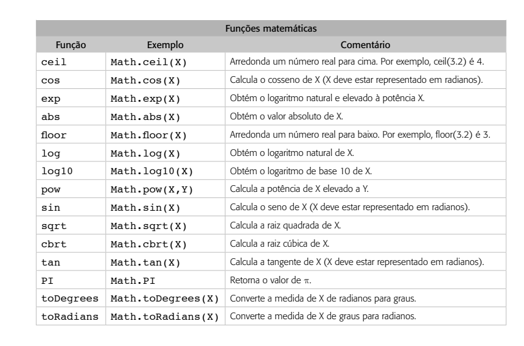

### Cap 4 - Estrutura condicional 

As estruturas condicionais podem ser simples (se -> então) ou composta (se -> então ->  senão )

#### 4.4 Estrutua condicional em JAVA 

- simples

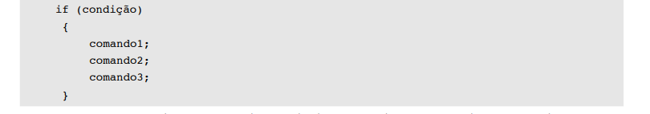

- Composta 

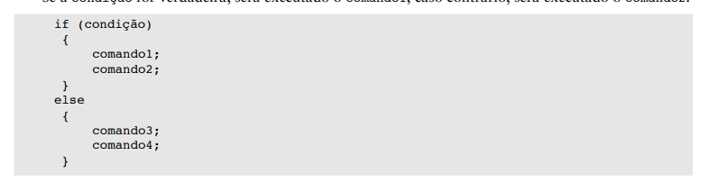

- estrutura case 

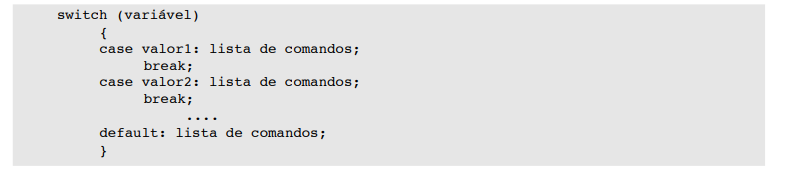

- operadores  lógico  (&&[e], || [ou], ![e])

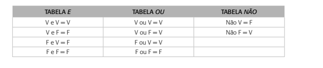


### Cap 5 - Estrutura de repetição

Estrutura de repetição são estruturas que fazem que o algoritmo se repita por um número determinado ou infinitamente.

- Com número de repetições definidos (para)

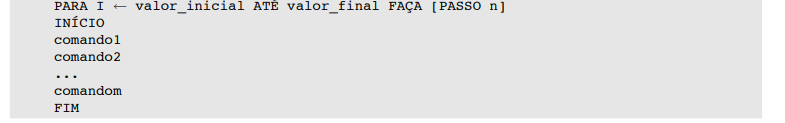

- com número indefinido e teste no ínicio (enquanto)

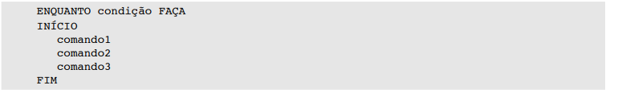

- com número indefinido e teste no final(repita)

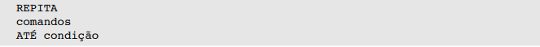

#### 5.4 Estrutura de reptição em JAVA 

- For(para )

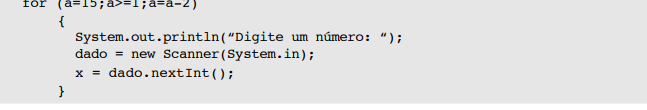

-while (enquanto)

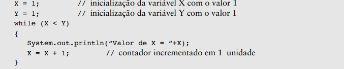


- do while (repita)

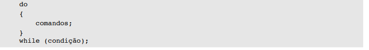
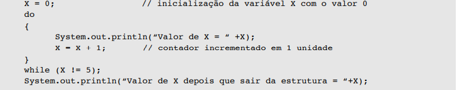

### Cap 6 - Vetor 

Um vetor é uma variável composta homogênea unidimensional, ou seja um conjunto de váriveis do mesmo tipo que possuem apenas um indenficador 
e são alocados sequencialmente na memória, também podendo ser chamado de array unidimensional.

exemplo:

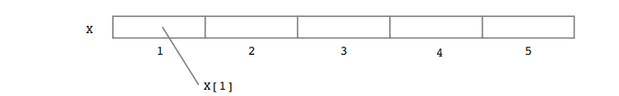

A atribuição de valores consiste no nome do vetor e sua posição, no caso de algumas linguagens o primeiro espaço na mémoria do computador consiste em um indíce 0

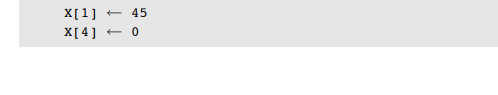

#### 6.4 Vetor em JAVA 

em java a posição do vetor inica em 0, sendo declarados depois da variavél.

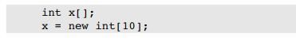

- atribuição de valores ao vetor

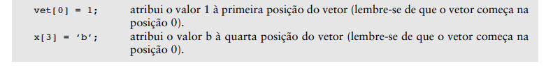

-prenchendo um vetor 

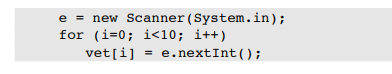

-mostrando os elementos do vetor 

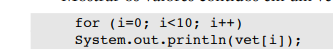

### Cap 7 - Matriz 

Uma matriz é um variável homogênea multidimensional  

- declaração de matriz 


- Exemplos de matriz 

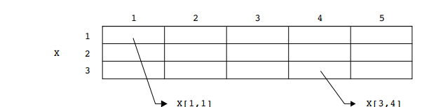


#### Matriz em JAVA

-Atribuindo valores 

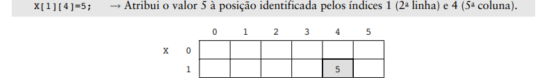

-preenchendo uma matriz 

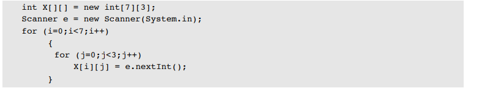

-mostrando os elementos de uma matriz 

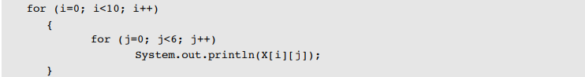

### Cap 8 - subrotinas

Uma sub-rotina é um bloco de código separado que executa uma tarefa específica e pode ser chamado (invocado) várias vezes em diferentes partes de um programa.

#### Subrotinas em JAVA(métodos)

As sub-rotinas em java se resume basicamente em seus métodos, em java cada classe tem seu atributo(informação da variavel ) e  suas funções que são seus métodos,
além disso em java esses métodos exercem influência de diversos modificadores de acesso entre os principais o static e public, o static  diz que o método podera ser executado sem nenhum objeto da classe instanciado  e publico que o método pode ser chamado por qualquer classe


- Sem Retorno e Sem Parâmetros

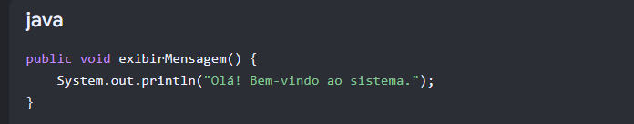

- Sem Retorno e Com Parâmetros

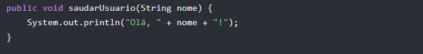

- com retorno e sem parâmetro

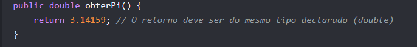

- com retorno e com parâmetro

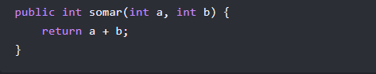


### Cap 9- Manipulando cadeias de caracters  (em java)

1) Inicalização de string

String texto1 = new String();

* Métodos essenciais da classe String

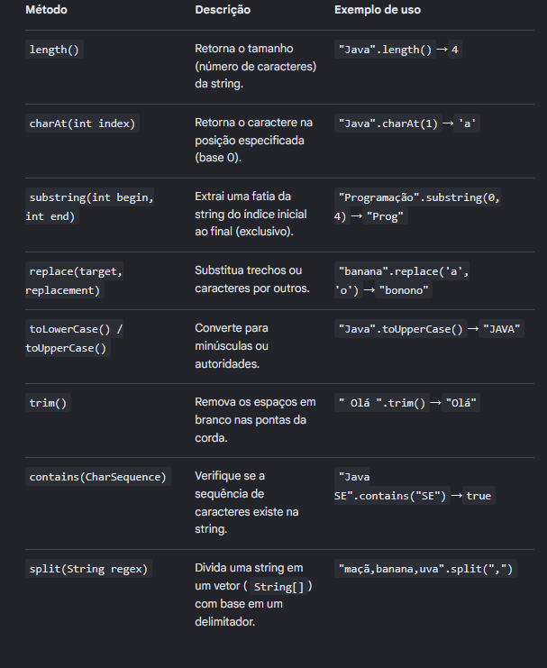

### Cap 10 - Registro

Registros (Records) em Java são estruturas de dados introduzidas para simplificar a criação de classes que servem puramente como portadoras de dados imutáveis. Como você bem mencionou, eles têm o objetivo principal de agregar vários dados (atributos) acerca de uma mesma entidade de forma muito mais limpa e compacta.

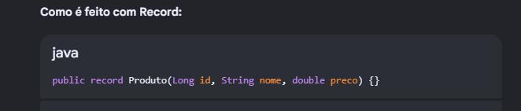


O que o Java gera automaticamente para você nos bastidores:

• Atributos privados e finais: private final Long id;, etc.

• Um constutor completo para inicializar todos os dados.

• Métodos de leitura (em vez de getId(), usa-se apenas .id()).

• Implementações robustas de toString(), equals() e hashCode().


* obs questões sobre tratamentos de arquivos e poo serão tratadas na matérias de programação orientada a objeto.


