Disciplina de circuitos digitais 

## Materiais 

Livro base: Sistemas Digitais: Fundamentos e Aplicações -Floyd, Thomas L.

curso de circuitos digitais do professor Pedro Souza:   https://www.youtube.com/playlist?list=PLXyWBo_coJnMYO9Na3t-oYsc2X4kPJBWf

provas e exercícios da ufpr do curso de computação :https://www.inf.ufpr.br/fabiano/ci068/ 

meta de aprendizagem :

1cap a cada 2 dias  (fim em 19/11/2026 ) - **55p**

- sobre os problemas: 

básicos (B), complicados (C), análise de defeitos (T, de troubleshooting), novos (N), projeto
(D, de design) e HDL (H).


## 01 - Conceitos introdutórios

### 1.1 Introdução a 1s e 0s digitas

Todos os sistemas digitais trabalham com coisas em dois estaods
 **ligado ou desligado** sendo esses estados podendo ser representados por **0 ou 1**

Como podemos representar o sistema em apenas esses estados, chamamos eles de **dígitos binários ou bits (binary digit)**, em sistemas 
em que é preciso estar em estados intermediarios entre os dois se usa um conjunto de outras numerações que nos ajudam
a definir o estado do sistema, sendo esses estados chamados de **estados lógicos**

As representações eletricas depende da tecnologia do sistema, entretanto no geral
**0 representa baixa tensão(perto de 0V ) e 1 tensões mais altas** , sendo esses valores tratados como **níveis lógicos**

Para entender o momento de cada nível lógico para interações presentes e futuras no sistema, usamos um **diagrama de tempo**.


### 1.2 Sinais Digitais 

Todo sinal digital de um circuito tende a ter um momento de alteração onde
seu valor lógico se altera de alto pra baixo e vice versa, esse momento de transição dos estado é chamado de  **borda**,
sendo que quando é de alto pra baixo é chamado de **borda de descida** e o contrário de 
**borda de subida**

#### Estipulação de tempo (sinal periódico e não periodico)

Todos os circuitos digitais tendem a ter uma relação de tempo com os sinais (ligado ou desligado)
que pode ser recorrente ou não, quando recorrente ele é chamado de **sinal periodico** ou seja sempre ocorre em determinado 
tempo como por exemplo um poste de luz que liga e desliga em determinado horario.

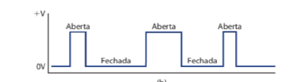

Agora quando não recorrente esse sinal é denominado de **sinal não periódico**, um
exemplo disso é um sensor de porta de micro-ondas que funciona de maneira diferente sempre e não se tem um padrão 
próprio do circuito a menos que o usuário se crie um.


o sinal é passado por meio de ondas, essas ondas seja qual for(eletrica ou de radio) são retradas por periódos
sendo seu periodo a quantidade de tempo por ciclo (segundos/ciclos) e sua frequência como o numero de ciclos por tempo ou seja frequencia e periodo são recíprocos.

Em outras palavras a frequencia mostra quando ciclos completos cabem dentro de 1s ou mais tempo
enquanto o periodo e quanto tempo uma unica onda demora .


#### Ciclos de trabalho 

Além da frequência e do periodo, temos os ciclos de trabalho (Duty Cycle ) que mostra
em porcentagem quando do sistema está trabalhando  durante todo tempo. Vamos visualizar da seguinte forma.

Imagine que **1 ciclo completo** (o período total da onda) dura **10 segundos**:

##### Exemplo 1: Ciclo de Trabalho de 50% (Onda Quadrada Padrão)
*O sinal passa exatamente metade do tempo ligado e metade desligado.*
```text
Ligado (5s)     Desligado (5s)
  +-----+       +-----+        

  |     |       |     |        
--+     +-------+     +-------
```

##### Exemplo 2: Ciclo de Trabalho de 20%
*O sinal dá apenas um pulso rápido e passa a maior parte do tempo desligado.*
```text
Lig (2s)   Desligado (8s)
  +-+      +-+                 

  | |      | |                 
--+ +------+ +------
```

##### Exemplo 3: Ciclo de Trabalho de 80%
*O sinal passa quase o tempo todo ligado, com apenas breves piscadas desligado.*
```text
Ligado (8s)       Desl (2s)
  +-------+       +-------+    

  |       |       |       |    
--+       +-------+       +-------
```

---

##### 🧮 Fórmula Matemática

A conta para descobrir a porcentagem do ciclo de trabalho é:

$$\text{Ciclo de Trabalho (\%)} = \left( \frac{\text{Tempo Ligado}}{\text{Tempo Total do Período}} \right) \times 100$$

---

#### transições 

as medidas das bordas ou seja a transição entre baixo e alto acontece quando  são tiradas do ponto 50% da forma da onda.


#### Limites e eventos 

Sempre que um sistema tiver apenas dois estados, essa ato mudar e chamado de **evento**,
sendo que determinados circuitos só respondem quando tem determinados níveis lógicos, pra esses
sistemas chamamos eles de **sensíveis a nível**.Quando eles respondem a bordas de subida ou de descida são chamado de **sensíveis a borda**

### 1.3 CIRCUITOS LÓGICOS E TECNOLOGIA ENVOLVIDA

Os circuitos digitais respondem a uma entrada que por sua vez contém a lógica do circuito, cada circuito recebe uma conjunto de regras
e por isso são chamados de **circuitos lógicos**

Existem vários tipos de circuitos lógicos que vai ser explicado separadamente.

#### Circuitos digitais integrados(CIs)

são circuitos que integrados a outros que são altamente sofisticados e feito sobe medida pra uma aplicação.
Os circuitos digitas são os **CMOS  que siginifica  metal-óxido-semicondutor complementar** (do inglês, complementary metal-oxide semiconductor),
além disso a melhor familia lógica usada hoje em dia são os **TTL ou lógica de transistor-transistor** (do inglês, transistor-transistorlogic)

### 1.4 Representações númericas 

Existem dois modos de representação de valores em quantidades em circuitos, **o analógico e o digital** .

#### Representação analógicas 

Nos sistemas analógicos elétricos a  quantidade física medida ou processada é convertida em uma tensão ou corrente proporcional(sinal elétrico), sendo
representado por um indicador proporcional continuamente variável.

#### Representação digital 

Nos sistemas digitais as quantidades são representados por símbolos chamados digitos .
ou seja a maior diferença é:

````
Analógica = contíniua
Digital = discreta (passo a passo) 
````

A representação digital é o resultado da atribuição de
um número de precisão limitada a uma quantidade continuamente variável


### 1.5 SISTEMAS ANALÓGICOS E DIGITAIS

Um sistema digital é uma combinação de dispositivos que fornece  quantidades fisicas em formato digital ou seja com valores 
discretos(passo a passo) e um sistema analofico contem dispositivos que manipulam a quantidade fisica representada  na foram analogica.


#### Vantagem de técnicas digitais 


1) são faceis de projetar
2) o armazenamento de informação é fácil
3) e mais fácil manter a precisão e exatidão em todo o sistema
4) As operações podem ser programadas
5) os circuitos digitais são menos afetados por ruido
6) Mais circuitos digitais podem ser fabricados em chips 

#### Desvantagem de técnicas digitais 

1) O processamento de analogico pra digital sempre vai apresentar erros 
2) Processar sinais leva tempo 

Para obter vantagens das técnicas digitais ao lidarmos com entradas e
saídas analógicas, devemos seguir quatro passos:
1. Converter a variável física em um sinal elétrico (analógico).
2. Converter os sinais elétricos(analógicos) para o formato digital.
3. Realizar o processamento (operação) da informação digital.
4. Converter as saídas digitais de volta ao formato analógico (o formato
   do mundo real).

Pra realizar esse metodo é necessário  esse tipo de técnica e o  **conversor analógico-digital (ADC — do inglês, analog-to-
-digital converter).** e um **conversor digital-analógico (DAC — do inglês, digital-to-analog converter).** 

### 1.6 SISTEMAS DE NUMERAÇÃO DIGITAL

Pra lidar com sinais digitais usamos três sistemas de númeração, **binário, decimal e hexadecimal.**

Dentro desses sistemas tempos o  **MSD -dígito mais significativo(do
inglês, most significant digit)** E O **LSD -dígito menos significativo(do inglês, least significant digit))** que servem como parâmetros de mínimos e máximos de um número.

#### Sistema decimal

composto por 10 numerais: 0,1,2,3,4,5,6,7,8,9 por conta disso também é chamado de sistema de base 10, sendo a posição 
do número responsável pelo seu valor ou seja é um sistema posicional de certo modo.

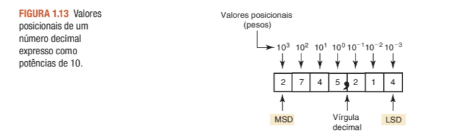

seu contador é de forma continua ou seja ele se move por cada número até não poder ter mais disponivel naquela casa e assim ter que adicionar mais 
uma nova casa 

#### Sistema Binário 

composto por 2 numerais : 0 ou 1 ele assim como o decimal tem seu valor posicional e podendo ser convertido pra decimal ou hexadecimal. Nesse sistema 
diferente do sistema decimal a posição a esqueda são potência de 2 com espoente positivo e a posição inical com espoente zero.

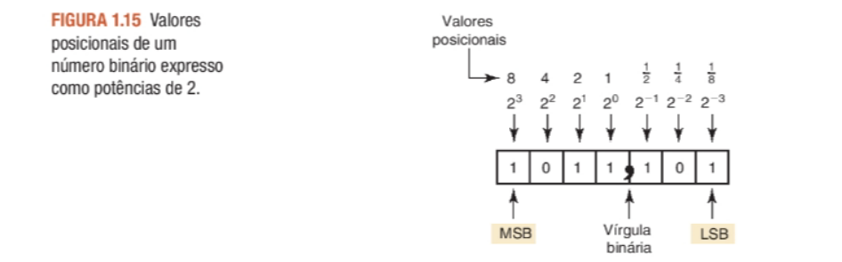

sendo o maior número que um conjunto de um byte pode conter é 255(10)

#### Contagem  em binario 

macete: 

1. não zero: 0
2. Adicione um: 1 (O dígito chegou ao limite!)
3. Zere à direita e "vai um" para a esquerda: 10 (Este é o número 2)
4. Adicione um na direita: 11 (Este é o número 3. Ambas as casas estão no limite!)
5. Zere tudo e adicione uma nova casa à esquerda: 100 (Este é o número 4)

• Decimal 0 = Binário0

• Decimal 1 = Binário1

• Decimal 2 = Binário10

• Decimal 3 = Binário11

• Decimal 4 = Binário100

• Decimal 5 = Binário101

• Decimal 6 = Binário110

• Decimal 7 = Binário111

• Decimal 8 = Binário1000

• Decimal 9 = Binário1001

• Decimal 10 = Binário1010

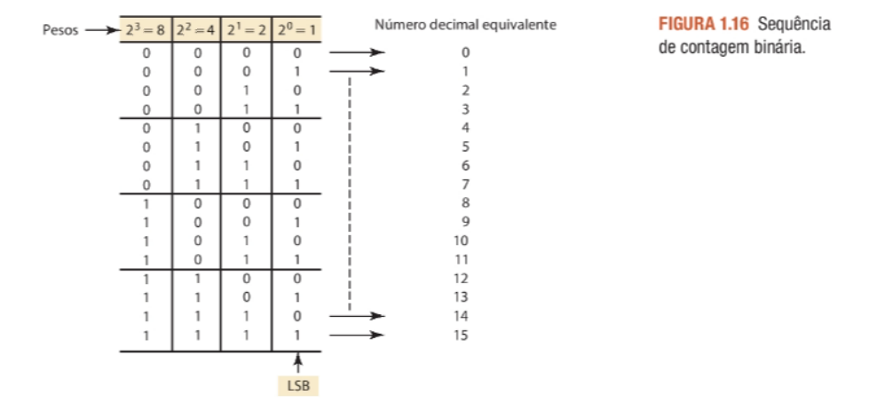

#### Calculo de conversão entre binário e decimal

1) de binario pra decimal 

**1.1) multiplicação de dígitos (soma dos pesos)** 

Multiplique cada dígito do número binário pela potência de 2 correspondente à sua posição, da direita para a esquerda (começando em 2⁰), e somando os resultados:

• Exemplo: Conversor 1101 para decimal

• (1 × 2³) + (1 × 2²) + (0 × 2¹) + (1 × 2⁰)

• 8 + 0 + 2 + 1 = 11 (decimal)

**1.2) Regra do dobro e soma**

1. Comece com o primeiro dígito à esquerda (que sempre é 1 em números binários válidos).
2. Multiplique o total anterior por 2 e some o dígito atual .
3. Repita o processo até o último dígito à direita.

Exemplo: Conversor\(1011_{2}\)

• Começa com o primeiro bit: 1
• Próximo bit (0):((1 * 2) + 0 = 2
• Próximo bit (1):((2 * 2) + 1 = 5
• Próximo bit (1):((5 * 2) + 1 = 11{10}

2) decimal pra binário

**2.1) dividi por dois** 

Divida o número decimal sucessivamente por 2. Anote os restos de cada divisão (0 ou 1). O resultado binário é formado pelos restos lidos do último para o primeiro (de baixo para cima).
• Exemplo: Converter 25 para binário

• 25 ÷ 2 = 12 com resto 1

• 12 ÷ 2 = 6 com resto 0

• 6 ÷ 2 = 3 com resto 0

• 3 ÷ 2 = 1 com resto 1

• 1 ÷ 2 = 0 com resto 1

• Lendo os restos de baixo para cima: 11001

Faixa de contagem 

Usando N bits, pode-se representar números decimais na faixa de 0 a
2^n - 1, em um total de 2^n números diferentes.

#### Notação em bases númericas 

pra cada número que for feito o cálculo e importante colocar o número embaixo dele pra representar e não confundir a qual sistema ele pertence.

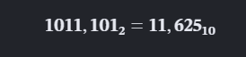

### 1.7 REPRESENTAÇÃO DE SINAIS COM QUANTIDADES NUMÉRICAS

Um sinal análogico é representado em binário em sistemas digitais.

### 1.8  TRANSMISSÕES PARALELA E SERIAL
 
OS bits são transmitidos por duas formas, de formma unica com os bits sendo transmitidos em série (transimissão serial) e de forma compartilhada
com os bits sendo transmitidos simultamnemeamente por várias linhas. 

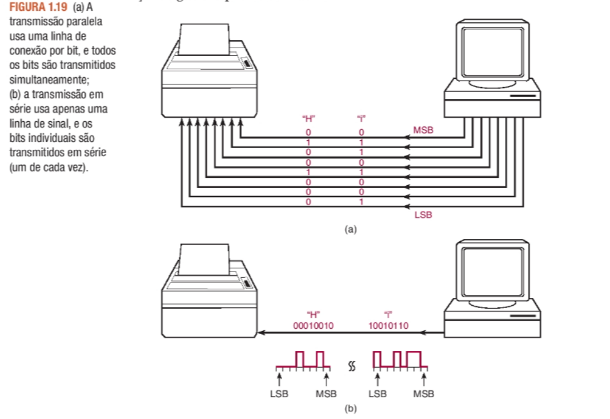


em transmissão paralela a velocidade do circuito é maior em contrapartida a sua complexidade maior e em transmissão serial o contrário.

### 1.9 MEMÓRIA

**A mémoria é a propriedade de retenção da resposta a uma entrada momentânea.** Nos dispositivos e circuitos ela serve como armazenamento temporário ou 
permanente de números binários, podendo alatera a informação contida. 

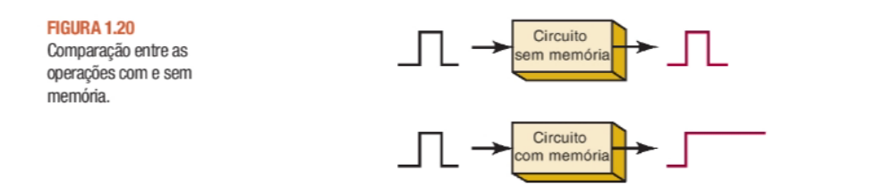

### 1.10  COMPUTADORES DIGITAIS 

um computador é um sistema de hardware que realiza operações aritméticas, manipula dados (normalmente na forma binária) e toma decisões.

Um programa é um conjunto de instruções que um computador recebe pra relaizar uma determinada ação.

#### Principais partes de um computador 

1) unidade de entrada: onde as instruções e dados sõa passados para o computador 
2) Unidade de mémoria : onde armazena as instruções e dados recebidos 
3) Unidade de controle : unidade responsável pela busca de instruções na unidade de mémoria e as interpreta.
4) Unidade lógica/aritemética(CPU) :Todos os cálculos aritimeticos e decisões são realizados por essa unidade (obs: pode ser envidados pra unidade de mémoria )
5) Unidade de sáida: Apresenta os dados da mémoria ou de outra forma e exibe ao operador (ou processa)

As unidades lógicas são consideradas uma **unidade central de processamento CPU (do inglês, central processing unit)** contendo circuito de busca e decodificação(interpretação)
de intruções e controle e realização de operações determinadas pelas instruções.

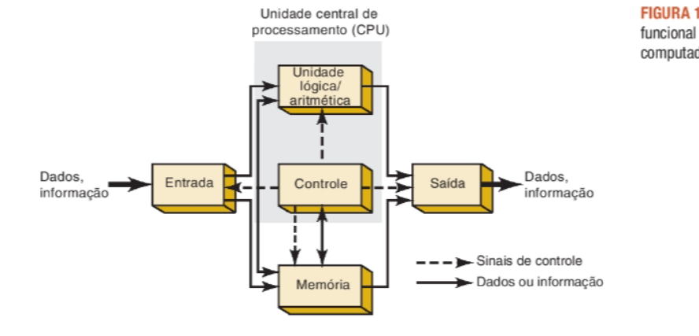


#### Tipos de computadores 

Vamos definir os tipos de conputadores porém tem várias nomeclaturas e quantidades diferentes que podem ser resumidas nas cinco partes anteriore.

outas questões: 

microprocessadores = CPU integradas em um chip bastante pequeno

microcomputadores =  microprocessadores integrados a circuitos de mémoria, entrada e sáida.

microcomputador =  microcomputadores feitos para um sistema ou tarefa específicas

1) computadores de ponta : Os computadores de ponta são sistemas muito poderosos capazes de lidar com muitas tarefas e produzir resultados muito rapidamente.
outros nomes conhecidos são supercomputadores, clusters, servidores e mainframes, geralmente composto de vários computadores trabalhando junto.

2) Computadores pessoais:  um computador geral que pode ser usados pra várias aplicações por uma pessoa individualmente. 

3) computadores embarcados:Um computador embarcado é um computador comum (com processador, memória e entradas), mas com duas regras muito claras :

1. Ele fica "escondido" (embarcado) dentro de um produto maior. Ele não parece um computador com teclado, mouse e monitor. Ele é apenas uma placa verde com chips parafusados ​​dentro do aparelho.
2. Ele só sabe fazer uma única tarefa. Ele nasce, vive e morre fazendo apenas a função do objeto onde foi colocado.

ex: microondas


## 02 - SISTEMAS DE NUMERAÇÃO E CÓDIGOS

### 2.3  SISTEMA DE NUMERAÇÃO HEXADECIMAL

Sistema de 16 digitos que vai de 0,1,2,3,4,5,6,7,8,9,A,B,C,D,E,F


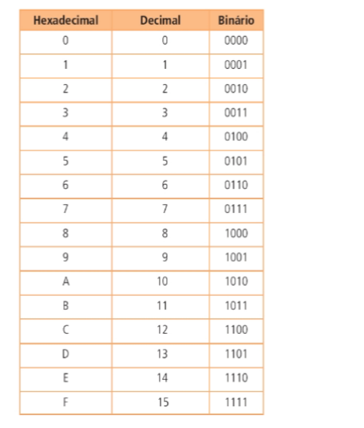]


#### Conversõo de hexa em decimal


1) por valor relativo vs valor do peso somandos


#### Conversão de decimal em hexa

1) dividindo por 16 

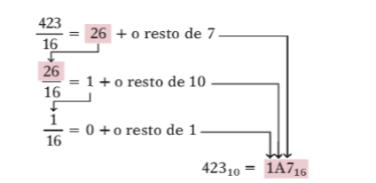


#### Conversão de hexa em binário 

1) agrupamento de 4 bits

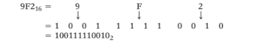


#### Conversão de binário em hexa

1) agrupamento de bits 

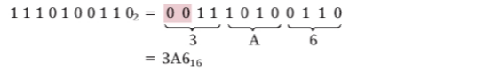

#### Contagem em hexadecimal

Acrescenta conforme sua posição no sistema

(a) 38, 39,3A, 3B, 3C, 3D, 3E, 3F, 40, 41, 42

### Vantagens do sistemas hexadecimais 

1) trabalho de vários bits 
2) mais maneiras de contagemns 


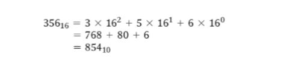