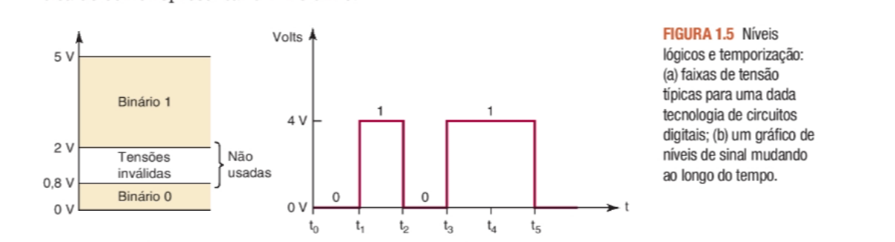
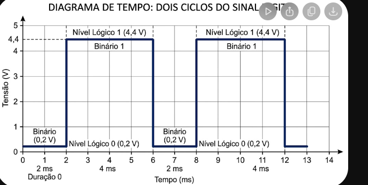
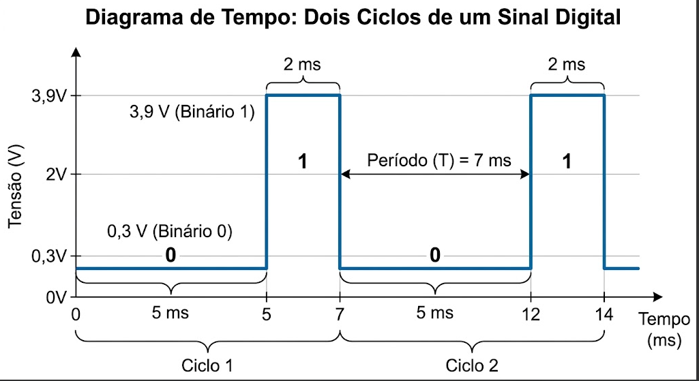

## 1.1 introdução a 0 e 1 digitais 

1. Quais são os dois dígitos numéricos usados para representar estados
em um sistema digital?

R: 0 (desligado) e 1(ligado)

2. Quais são os dois termos utilizados para representar os dois níveis
   lógicos?

R: ALTO e BAIXO

3. Qual é a abreviatura do dígito binário?

R: BIT - binary digit

4. Que valor de dígito binário é tipicamente representado por tensão
   baixa (quase zero)?

R: 0

5. Qual tensão representa o valor do dígito binário de 1?

R: ALTA 

6. A qual nível lógico em geral é atribuído um valor de 1?

R: ALTA 

7. Qual é o nível lógico produzido na Figura 1.4(a) quando a chave é
   removida?

R: ALTA e verdadeiro(1)

8. De acordo com a Figura 1.5, qual é a menor tensão que seria reconhecida como nível lógico 1?

r:  2v 

9. De acordo com a Figura 1.5, qual é a maior tensão que seria reconhecida como nível lógico 0?

r: 0,8V

10. De acordo com a Figura 1.5, como uma tensão de 1,0 V seria
    reconhecida?

r: tensão inválida

## 1.2 sinais digitais 

1) Desenhe um diagrama de tempo que mostre quando uma pessoa
está em horário de trabalho durante uma semana inteira. Comece
na segunda-feira de manhã. O diagrama terá uma entrada que representa o ciclo dia/noite (assumir equinócio, em que o comprimento
do dia = comprimento da noite — amanhecer às 6h e crepúsculo às
18h) e uma saída ALTA representando quando uma pessoa está em
horário de trabalho. Suponha que ela tenha um típico trabalho das
8h às 17h, de segunda a sexta-feira, com sábado e domingo livres.

2. A forma de onda “em_horário_de_trabalho” no diagrama da pergunta anterior é periódica ou não periódica?

R: periodidca

3. Consulte a Figura 1.11.

(a) A forma de onda de entrada é periódica?

R: sim 

b) Qual é o período da forma de onda de entrada em segundos?

R:  t= 4ms 

(c) Qual é o ciclo de trabalho ativo-ALTO da forma de onda de
entrada?

R:  ciclo de trabalho  = 1/4 *100 = 25%

(d) Qual é a frequência da forma de onda em Hz?

R: f= 1/ 0,004s =  250hz

(e) Que tipo de evento na entrada causa uma alteração na saída?

R: evento de sensivel a borda de descida

(f) Qual é o período da forma de onda de saída em segundos?

R: t = 8ms

(g) Qual é a frequência da forma de onda de saída em Hz?

R: f= 1/0,008s = 125hz

## 1.3 CIRCUITOS LÓGICOS E TECNOLOGIA ENVOLVIDA

1. Verdadeiro ou falso: o valor exato de uma tensão de entrada é crítico
   para um circuito digital.

R: FALSO 

2. Um circuito digital pode produzir a mesma tensão de saída para
   diferentes valores de tensão e corrente de entrada?

r: verdadeiro

3. Um circuito digital também é referido como um circuito________ .

R: circuito lógico

4. A tecnologia mais prevalente utilizada para circuitos digitais hoje é
   abreviada como________ .

r: CMOS 

5. Esse acrônimo representa____________________________________ .

R:metal-óxido-semicondutor complementar

6. Os sistemas antigos do passado utilizam uma tecnologia abreviada
   como________ .

R:TTL 

7. O tipo de transistor utilizado em sistemas antigos foi o transistor

T: transistor bipolar

### 1.4 Representações númericas 

Dentre as alternativas a seguir, quais estão relacionadas a quantidades
analógicas e quais estão relacionadas a quantidades digitais?

(a) Subida usando uma escada. - digital 
(b) Subida usando uma rampa. - analogico
(c) Corrente que flui de uma tomada elétrica por um motor. - analogico
(d) Altura de uma criança medida por uma fita métrica em divisão de 1 cm. -digital
(e) Altura de uma criança colocando uma marca na parede. - analogico
(f) Quantidade de pedras em um balde. -  digital
(g) Quantidade de areia em um balde. -  digital
(h) Volume de água em um balde -  analogico

1. Qual método de representação de quantidades envolve etapas
   discretas?

R: digital

2. Qual método de representação de quantidades é continuamente
   variável?

R: análogico

3. Identifique cada alternativa como representação digital ou
   analógica:
   (a) Hora do dia usando um relógio de sol. - analogico
   (b) Hora do dia usando seu celular. - digital
   (c) Nível do volume de seu televisor de tela plana. -digital
   (d) Nível do volume do rádio do tubo de vácuo. - analogico
   (e) Medir a circunferência de uma bola de basquete em milímetros. - analogico
   (f) Medir a circunferência de uma bola de basquete envolvendo -analogico
   uma corda em tomo dela e cortando a corda para estipular o
   comprimento.

### 1.5 SISTEMAS ANALÓGICOS E DIGITAIS

1. Cite três vantagens dastécnicas digitais.

R: Fácil de projetar , melhor pra armazenar, maior precisão no siste

2. Liste as duas principais limitações das técnicas digitais

R:perda de valor de analogico pra digital e o processamento de sinais leva mais tempo que um análogico.

### 1.6 SISTEMAS DE NUMERAÇÃO DIGITAL

a) Qual é o maior número que pode ser representado usando-se oito bits?

R: 2n - 1 = 2^8 - 1 = 255(10) =  11111111(2)

1. Qual é o número decimal equivalente a 1101011(2)?

R:  1101011 =  1 + 2 + 8  + 32 +64 = 107(10)

2. Qual é o número binário seguinte a 10111, na sequência da contagem?

R:1101100 =108(10)

3. Qual é o valor do maior número decimal que pode ser representado
   usando-se 12 bits?

R: 111111111111(2) = 2^12 - 1 = 4096-1 = 4095

### 1.7 REPRESENTAÇÃO DE SINAIS COM QUANTIDADES NUMÉRICAS

Como um sinal analógico é representado em um sistema digital?

R: por digitos binarios 

### 1.8 TRANSMISSÕES PARALELA E SERIAL

1. Descreva as vantagens relativas das transmissões paralela e serial
   de um dado binário.

R: paralela é mais rápida mais tem muito mais fio enquanto a serial é mais lenta mais tem menos fio 

### 1.9 MEMÓRIA

1. Uma saída de circuito sem memória sempre depende da entrada  presente
   (passado, presente ou futuro).

2. Uma saída de circuito de memória depende de____entrada passadas ____ .

### 1.10 COMPUTADORES DIGITAIS

1. Nomeie as cinco principais unidades funcionais de um computador.

r: entrada, saida, memoria, controle e  arimetica/lógica(CPU) 

2. Quais são as duas unidades que compõem a CPU?

R: controle e aritmetica/lógica

3. Qual é a principal estratégia para melhorar as capacidades, a velocidade e a produção de sistemas de computação?

R: colocar mémoria 

4. Qual categoria possui o maior número de aplicativos de computador?

R: computadores pessoais 

5. Se você descobrir a maior invenção do século 21, que tecnologia
   muito provavelmente estará envolvida?

R: circuitos digitais 

### Problemas do capítulo 1 

1.1 Na Figura 1.22(a), qual é o nível lógico que
deve ser emitido para ligar o LED?

R: alto

1.2 Na Figura 1.22(b), qual é o nível lógico que
deve ser emitido para ligar o LED?

R: baixo

1.3 Na Figura 1.22(a), qual interruptor deve ser
fechado para ligar o LED?

R: S1

1.4 Na Figura 1.22(b), qual interruptor deve ser
fechado para ligar o LED?

R: S2

1.5 Crie um bom rótulo (nome) para cada sinal
descrito a seguir:

(a)* Um sensor emite um BAIXO quando a
porta do elevador está fechada.

R:porta fecha (L)

(b) Um sensor de luz de rua produz um
ALTO quando detecta a luz do dia.

R: Detecta luz (U)

(c) * Um sensor de assento do passageiro fica
BAIXO quando o assento está vazio.

R: assento abaixado (L)

(d) Um sensor de temperatura fica ALTO
quando o fluido do radiador está criticamente quente.

R: fluido do radiador quente (U)

1.6 Desenhe dois ciclos do diagrama de tempo
para um sinal digital que alterna continuamente entre 0,2 V (binário 0) durante 2 ms
e 4,4 V (binário 1) por 4 ms.

1.7 Meça o período, a frequência e o ciclo de
trabalho da forma de onda do Problema
1.6. Suponha que a parte ativa da forma de
onda seja ALTA.   

R: t = 6ms , f= 1/6ms = 166,66hz e ciclo de trablaho   4/6 *100 = 66,66%

1.8 Desenhe dois ciclos do diagrama de tempo
para um sinal que alterna entre 0,3V (binário 0) por 5 ms e 3,9 V (binário 1) por 2 ms.

R:

1.9 Meça o período, a frequência e o ciclo de
trabalho da forma de onda do Problema 1.8.
Suponha que a parte ativada forma de onda
seja BAIXA.

R: t= 7ms , f= 1/7ms ~= 143 e ciclo de trabalho = 5/7 * 100  = 71,43%

1.10 Rotule cada forma de onda na Figura 1.23:
periódica/não periódica. Para aquelas que
são periódicas,meça T, Fe ciclo de trabalho
(suponha o ALTO ativo).

a) periodica  - t= 2,5ms , f= 1/2,5ms = 400khz  e ciclo de trabalho  1/2,5 *100 = 40%

b) não periodica 

c) periodica -  t = 4ms, f = 1/4ms = 250hz e ciclo de trabalho 3/4 *100 = 75%

d) periodica  - t = 6ms, f= 1/6ms = 166,67hz e ciclo de trabalho  5,5/6 * 100 = 91,67%

1.11 * Quais das seguintes são quantidades analógicas e quais são digitais?

(a) Número de átomos em uma amostra
de material. - digital
(b) Altitude de uma aeronave. -analogica
(c) Pressão em um pneu de bicicleta. - analogica
(d) Corrente através de um alto-falante. -analogica
(e) Sua idade medida em anos. -digital

1.12 Quais das seguintes são quantidades analógicas e quais são digitais?

(a) Largura de uma peça de madeira. -analogico
(b) A quantidade de tempo antes de o som
de aviso do forno desligar. -analogico
(c) A hora do dia exibida em um relógio - digital 
de quartzo.
(d) Elevaçã omedida por etapas de contagem em uma escada.  -digital
(e) Elevação medida por um ponto em - analogico
uma rampa
(f) O peso de uma pessoa medido ao longo de um mês. - analogico
(g) O número de alunos presentes em uma sala de aula. -digital
(h) O volume de água em um balde é enchido por uma torneira. analogico
(i) A classificação do placar de um jogo de basquete. -digital
(j) A temperatura do corpo de uma pessoa medida com uma medição de mercúrio. - analogico

1.13 * Converta os seguintes números binários
para os valores decimais equivalentes.

(a) 11001, - 1+8+16 = 25(10)
(b) 1001,1001, - (8 +1) + ( 0,8 +0,01)  = 9,5625(10)
(c) 10011011001,101102  =  (1+8+16+64+128++1024) + (0,16+0,0002) = 1.241,703125(10)

1.14 Converta os seguintes números binários em
decimais.
(a) 10011 - 1+2+16 = 19(10)
(b) 1100,0101 - 4+8 + 0,5 +125 - 12,3125(10)
(c) 10011100100,10010 = 4+32+64+128+2048 + 0,5+0,0625 = 1252,5625(10)

1.15* Usando três bits, mostre a sequência de
  contagem binária de 000 a 111.

1) 000
2) 001
3) 010
4) 011
5) 100
6) 101
7) 110
8) 111

1.16 Usando seis bits, mostre a sequência de
contagem binária de 000000 a 111111.

000000 (0) | 17. 010000 (16) | 33. 100000 (32) | 49. 110000 (48)

000001 (1) | 18. 010001 (17) | 34. 100001 (33) | 50. 110001 (49)

000010 (2) | 19. 010010 (18) | 35. 100010 (34) | 51. 110010 (50)

000011 (3) | 20. 010011 (19) | 36. 100011 (35) | 52. 110011 (51)

000100 (4) | 21. 010100 (20) | 37. 100100 (36) | 53. 110100 (52)

000101 (5) | 22. 010101 (21) | 38. 100101 (37) | 54. 110101 (53)

000110 (6) | 23. 010110 (22) | 39. 100110 (38) | 55. 110110 (54)

000111 (7) | 24. 010111 (23) | 40. 100111 (39) | 56. 110111 (55)

001000 (8) | 25. 011000 (24) | 41. 101000 (40) | 57. 111000 (56)

001001 (9) | 26. 011001 (25) | 42. 101001 (41) | 58. 111001 (57)

001010 (10) | 27. 011010 (26) | 43. 101010 (42) | 59. 111010 (58)

001011 (11) | 28. 011011 (27) | 44. 101011 (43) | 60. 111011 (59)

001100 (12) | 29. 011100 (28) | 45. 101100 (44) | 61. 111100 (60)

001101 (13) | 30. 011101 (29) | 46. 101101 (45) | 62. 111101 (61)

001110 (14) | 31. 011110 (30) | 47. 101110 (46) | 63. 111110 (62)

001111 (15) | 32. 011111 (31) | 48. 101111 (47) | 64. 111111 (63)

1.17 * Qual é o númeromáximo que se pode contar
usando 10 bits?

R: 1111111111 = 1+2+4+8+16+32+64+128+256+512 = 1023

1.18 Qual é o número máximo que se pode contar
usando 14 bits?

R: 11111111111111 = 1+2+4+8+16+32+64+128+256+512 + 1024+2048.4096+8192 = 16383

1.19 * Quantos bits são necessários para se contar
até um máximo de 511?

R: 511

1.20 Quantos bits são necessários para se contar
até um máximo de 63

R: 6 bits

1.21 Qual do sseguintes aumentará/diminuirá a
qualidade do sinal digital?

(a) Aumentar o tempo entre as amostras.  -  -diminuira

(b) Aumentar o número de bits em cada - aumentara
amostra.

(c) Aumentar a frequência de amostragem. - aumentara

1.22 * Suponha que os valores inteiros decimais
de 0 a 15 sejam transmitidos em binário.

(a) Quantas linhas serão necessárias se a
representação em paralelo for usada?

R: 4 linha 

(b) Quantas linhas serão necessárias se a
representação em série for usada?

R:  1

