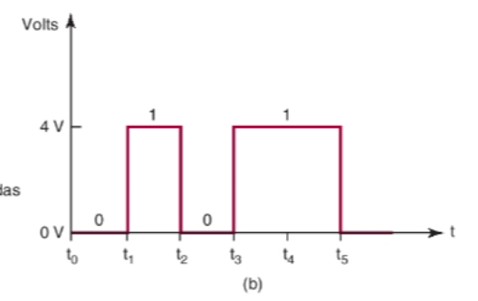
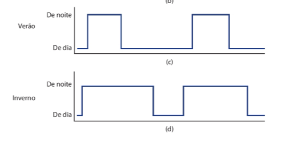
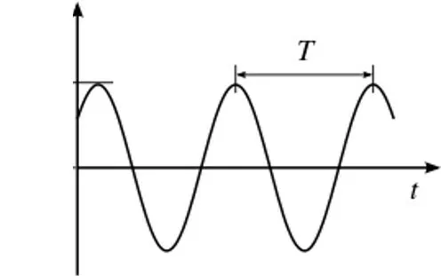
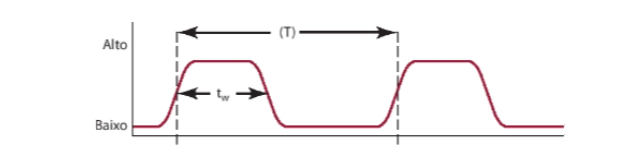

Disciplina de circuitos digitais 

Livro base: Sistemas Digitais: Fundamentos e Aplicações -Floyd, Thomas L.

complementares utilizados:Sistemas Digitais: Princípios e Aplicações

curso de circuitos digitais:   https://www.youtube.com/playlist?list=PLXyWBo_coJnMYO9Na3t-oYsc2X4kPJBWf

meta de aprendizagem :

1cap a cada 2 dias  (fim em 19/11/2026 ) - **32p**

- sobre os problemas: 

básicos (B), complicados (C), análise de defeitos (T, de troubleshooting), novos (N), projeto
(D, de design) e HDL (H).


## 01 - Conceitos introdutórios

### 1.1 Introdução a 1s e 0s digitas

Todos os sistemas digitais trabalham com coisas em dois estaods
 **ligado ou desligado** sendo esses estados podendo ser representados por **0 ou 1**

Como podemos representar o sistema em apenas esses estados, chamamos eles de **dígitos binários ou bits (binary digit)**, em sistemas 
em que é preciso estar em estados intermediarios entre os dois se usa um conjunto de outras numerações que nos ajudam
a definir o estado do sistema, sendo esses estados chamados de **estados lógicos**

As representações eletricas depende da tecnologia do sistema, entretanto no geral
**0 representa baixa tensão(perto de 0V ) e 1 tensões mais altas** , sendo esses valores tratados como **níveis lógicos**

Para entender o momento de cada nível lógico para interações presentes e futuras no sistema, usamos um **diagrama de tempo**.




### 1.2 Sinais Digitais 

Todo sinal digital de um circuito tende a ter um momento de alteração onde
seu valor lógico se altera de alto pra baixo e vice versa, esse momento de transição dos estado é chamado de  **borda**,
sendo que quando é de alto pra baixo é chamado de **borda de descida** e o contrário de 
**borda de subida**

#### Estipulação de tempo (sinal periódico e não periodico)

Todos os circuitos digitais tendem a ter uma relação de tempo com os sinais (ligado ou desligado)
que pode ser recorrente ou não, quando recorrente ele é chamado de **sinal periodico** ou seja sempre ocorre em determinado 
tempo como por exemplo um poste de luz que liga e desliga em determinado horario.


Agora quando não recorrente esse sinal é denominado de **sinal não periódico**, um
exemplo disso é um sensor de porta de micro-ondas que funciona de maneira diferente sempre e não se tem um padrão 
próprio do circuito a menos que o usuário se crie um.



o sinal é passado por meio de ondas, essas ondas seja qual for(eletrica ou de radio) são retradas por periódos
sendo seu periodo a quantidade de tempo por ciclo (segundos/ciclos) e sua frequência como o numero de ciclos por tempo ou seja frequencia e periodo são recíprocos.

Em outras palavras a frequencia mostra quando ciclos completos cabem dentro de 1s ou mais tempo
enquanto o periodo e quanto tempo uma unica onda demora .




#### Ciclos de trabalho 

Além da frequência e do periodo, temos os ciclos de trabalho (Duty Cycle ) que mostra
em porcentagem quando do sistema está trabalhando  durante todo tempo. Vamos visualizar da seguinte forma.

Imagine que **1 ciclo completo** (o período total da onda) dura **10 segundos**:

##### Exemplo 1: Ciclo de Trabalho de 50% (Onda Quadrada Padrão)
*O sinal passa exatamente metade do tempo ligado e metade desligado.*
```text
Ligado (5s)     Desligado (5s)
  +-----+       +-----+        

  |     |       |     |        
--+     +-------+     +-------
```

##### Exemplo 2: Ciclo de Trabalho de 20%
*O sinal dá apenas um pulso rápido e passa a maior parte do tempo desligado.*
```text
Lig (2s)   Desligado (8s)
  +-+      +-+                 

  | |      | |                 
--+ +------+ +------
```

##### Exemplo 3: Ciclo de Trabalho de 80%
*O sinal passa quase o tempo todo ligado, com apenas breves piscadas desligado.*
```text
Ligado (8s)       Desl (2s)
  +-------+       +-------+    

  |       |       |       |    
--+       +-------+       +-------
```

---

##### 🧮 Fórmula Matemática

A conta para descobrir a porcentagem do ciclo de trabalho é:

$$\text{Ciclo de Trabalho (\%)} = \left( \frac{\text{Tempo Ligado}}{\text{Tempo Total do Período}} \right) \times 100$$

---

#### transições 

as medidas das bordas ou seja a transição entre baixo e alto acontece quando  são tiradas do ponto 50% da forma da onda.



#### Limites e eventos 

Sempre que um sistema tiver apenas dois estados, essa ato mudar e chamado de **evento**,
sendo que determinados circuitos só respondem quando tem determinados níveis lógicos, pra esses
sistemas chamamos eles de **sensíveis a nível**.Quando eles respondem a bordas de subida ou de descida são chamado de **sensíveis a borda**

### 1.3 CIRCUITOS LÓGICOS E TECNOLOGIA ENVOLVIDA

Os circuitos digitais respondem a uma entrada que por sua vez contém a lógica do circuito, cada circuito recebe uma conjunto de regras
e por isso são chamados de **circuitos lógicos**

Existem vários tipos de circuitos lógicos que vai ser explicado separadamente.

#### Circuitos digitais integrados(CIs)

são circuitos que integrados a outros que são altamente sofisticados e feito sobe medida pra uma aplicação.
Os circuitos digitas são os **CMOS  que siginifica  metal-óxido-semicondutor complementar** (do inglês, complementary metal-oxide semiconductor),
além disso a melhor familia lógica usada hoje em dia são os **TTL ou lógica de transistor-transistor** (do inglês, transistor-transistorlogic)

### 1.4 Representações númericas 

Existem dois modos de representação de valores em quantidades em circuitos, **o analógico e o digital** .

#### Representação analógicas 

Nos sistemas analógicos elétricos a  quantidade física medida ou processada é convertida em uma tensão ou corrente proporcional(sinal elétrico), sendo
representado por um indicador proporcional continuamente variável.

#### Representação digital 

Nos sistemas digitais as quantidades são representados por símbolos chamados digitos .
ou seja a maior diferença é:

````
Analógica = contíniua
Digital = discreta (passo a passo) 
````

A representação digital é o resultado da atribuição de
um número de precisão limitada a uma quantidade continuamente variável


### 1.5 SISTEMAS ANALÓGICOS E DIGITAIS

Um sistema digital é uma combinação de dispositivos que fornece  quantidades fisicas em formato digital ou seja com valores 
discretos(passo a passo) e um sistema analofico contem dispositivos que manipulam a quantidade fisica representada  na foram analogica.


#### Vantagem de técnicas digitais 


1) são faceis de projetar
2) o armazenamento de informação é fácil
3) e mais fácil manter a precisão e exatidão em todo o sistema
4) As operações podem ser programadas
5) os circuitos digitais são menos afetados por ruido
6) Mais circuitos digitais podem ser fabricados em chips 

#### Desvantagem de técnicas digitais 

1) O processamento de analogico pra digital sempre vai apresentar erros 
2) Processar sinais leva tempo 

Para obter vantagens das técnicas digitais ao lidarmos com entradas e
saídas analógicas, devemos seguir quatro passos:
1. Converter a variável física em um sinal elétrico (analógico).
2. Converter os sinais elétricos(analógicos) para o formato digital.
3. Realizar o processamento (operação) da informação digital.
4. Converter as saídas digitais de volta ao formato analógico (o formato
   do mundo real).

Pra realizar esse metodo é necessário  esse tipo de técnica e o  **conversor analógico-digital (ADC — do inglês, analog-to-
-digital converter).** e um **conversor digital-analógico (DAC — do inglês, digital-to-analog converter).** 

### 1.6 SISTEMAS DE NUMERAÇÃO DIGITAL

Pra lidar com sinais digitais usamos três sistemas de númeração, binário, decimal e hexadecimal.


