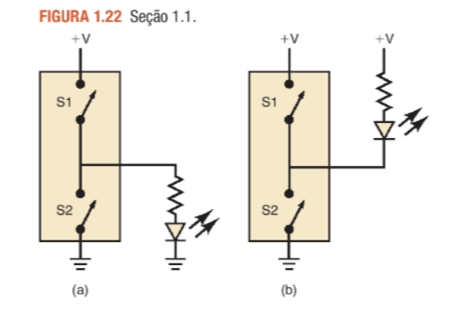

## 1.1 introdução a 0 e 1 digitais 

1. Quais são os dois dígitos numéricos usados para representar estados
em um sistema digital?

R: 0 (desligado) e 1(ligado)

2. Quais são os dois termos utilizados para representar os dois níveis
   lógicos?

R: ALTO e BAIXO

3. Qual é a abreviatura do dígito binário?

R: BIT - binary digit

4. Que valor de dígito binário é tipicamente representado por tensão
   baixa (quase zero)?

R: 0

5. Qual tensão representa o valor do dígito binário de 1?

R: ALTA 

6. A qual nível lógico em geral é atribuído um valor de 1?

R: ALTA 

7. Qual é o nível lógico produzido na Figura 1.4(a) quando a chave é
   removida?

R: ALTA e verdadeiro(1)

8. De acordo com a Figura 1.5, qual é a menor tensão que seria reconhecida como nível lógico 1?

r:  2v 

9. De acordo com a Figura 1.5, qual é a maior tensão que seria reconhecida como nível lógico 0?

r: 0,8V

10. De acordo com a Figura 1.5, como uma tensão de 1,0 V seria
    reconhecida?

r: tensão inválida

## 1.2 sinais digitais 

1) Desenhe um diagrama de tempo que mostre quando uma pessoa
está em horário de trabalho durante uma semana inteira. Comece
na segunda-feira de manhã. O diagrama terá uma entrada que representa o ciclo dia/noite (assumir equinócio, em que o comprimento
do dia = comprimento da noite — amanhecer às 6h e crepúsculo às
18h) e uma saída ALTA representando quando uma pessoa está em
horário de trabalho. Suponha que ela tenha um típico trabalho das
8h às 17h, de segunda a sexta-feira, com sábado e domingo livres.

2. A forma de onda “em_horário_de_trabalho” no diagrama da pergunta anterior é periódica ou não periódica?

R: periodidca

3. Consulte a Figura 1.11.

(a) A forma de onda de entrada é periódica?

R: sim 

b) Qual é o período da forma de onda de entrada em segundos?

R:  t= 4ms 

(c) Qual é o ciclo de trabalho ativo-ALTO da forma de onda de
entrada?

R:  ciclo de trabalho  = 1/4 *100 = 25%

(d) Qual é a frequência da forma de onda em Hz?

R: f= 1/ 0,004s =  250hz

(e) Que tipo de evento na entrada causa uma alteração na saída?

R: evento de sensivel a borda de descida

(f) Qual é o período da forma de onda de saída em segundos?

R: t = 8ms

(g) Qual é a frequência da forma de onda de saída em Hz?

R: f= 1/0,008s = 125hz

## 1.3 CIRCUITOS LÓGICOS E TECNOLOGIA ENVOLVIDA

1. Verdadeiro ou falso: o valor exato de uma tensão de entrada é crítico
   para um circuito digital.

R: FALSO 

2. Um circuito digital pode produzir a mesma tensão de saída para
   diferentes valores de tensão e corrente de entrada?

r: verdadeiro

3. Um circuito digital também é referido como um circuito________ .

R: circuito lógico

4. A tecnologia mais prevalente utilizada para circuitos digitais hoje é
   abreviada como________ .

r: CMOS 

5. Esse acrônimo representa____________________________________ .

R:metal-óxido-semicondutor complementar

6. Os sistemas antigos do passado utilizam uma tecnologia abreviada
   como________ .

R:TTL 

7. O tipo de transistor utilizado em sistemas antigos foi o transistor

T: transistor bipolar

### 1.4 Representações númericas 

Dentre as alternativas a seguir, quais estão relacionadas a quantidades
analógicas e quais estão relacionadas a quantidades digitais?

(a) Subida usando uma escada. - digital 
(b) Subida usando uma rampa. - analogico
(c) Corrente que flui de uma tomada elétrica por um motor. - analogico
(d) Altura de uma criança medida por uma fita métrica em divisão de 1 cm. -digital
(e) Altura de uma criança colocando uma marca na parede. - analogico
(f) Quantidade de pedras em um balde. -  digital
(g) Quantidade de areia em um balde. -  digital
(h) Volume de água em um balde -  analogico

1. Qual método de representação de quantidades envolve etapas
   discretas?

R: digital

2. Qual método de representação de quantidades é continuamente
   variável?

R: análogico

3. Identifique cada alternativa como representação digital ou
   analógica:
   (a) Hora do dia usando um relógio de sol. - analogico
   (b) Hora do dia usando seu celular. - digital
   (c) Nível do volume de seu televisor de tela plana. -digital
   (d) Nível do volume do rádio do tubo de vácuo. - analogico
   (e) Medir a circunferência de uma bola de basquete em milímetros. - analogico
   (f) Medir a circunferência de uma bola de basquete envolvendo -analogico
   uma corda em tomo dela e cortando a corda para estipular o
   comprimento.

### 1.5 SISTEMAS ANALÓGICOS E DIGITAIS

1. Cite três vantagens dastécnicas digitais.

R: Fácil de projetar , melhor pra armazenar, maior precisão no siste

2. Liste as duas principais limitações das técnicas digitais

R:perda de valor de analogico pra digital e o processamento de sinais leva mais tempo que um análogico.

### 1.6 SISTEMAS DE NUMERAÇÃO DIGITAL

a) Qual é o maior número que pode ser representado usando-se oito bits?

R: 2n - 1 = 2^8 - 1 = 255(10) =  11111111(2)

1. Qual é o número decimal equivalente a 1101011(2)?

R:  1101011 =  1 + 2 + 8  + 32 +64 = 107(10)

2. Qual é o número binário seguinte a 10111, na sequência da contagem?

R:1101100 =108(10)

3. Qual é o valor do maior número decimal que pode ser representado
   usando-se 12 bits?

R: 111111111111(2) = 2^12 - 1 = 4096-1 = 4095

### 1.7 REPRESENTAÇÃO DE SINAIS COM QUANTIDADES NUMÉRICAS

Como um sinal analógico é representado em um sistema digital?

R: por digitos binarios 

### 1.8 TRANSMISSÕES PARALELA E SERIAL

1. Descreva as vantagens relativas das transmissões paralela e serial
   de um dado binário.

R: paralela é mais rápida mais tem muito mais fio enquanto a serial é mais lenta mais tem menos fio 

### 1.9 MEMÓRIA

1. Uma saída de circuito sem memória sempre depende da entrada  presente
   (passado, presente ou futuro).

2. Uma saída de circuito de memória depende de____entrada passadas ____ .

### 1.10 COMPUTADORES DIGITAIS

1. Nomeie as cinco principais unidades funcionais de um computador.

r: entrada, saida, memoria, controle e  arimetica/lógica(CPU) 

2. Quais são as duas unidades que compõem a CPU?

R: controle e aritmetica/lógica

3. Qual é a principal estratégia para melhorar as capacidades, a velocidade e a produção de sistemas de computação?

R: colocar mémoria 

4. Qual categoria possui o maior número de aplicativos de computador?

R: computadores pessoais 

5. Se você descobrir a maior invenção do século 21, que tecnologia
   muito provavelmente estará envolvida?

R: circuitos digitais 

### Problemas do capítulo 1 

1.1 Na Figura 1.22(a), qual é o nível lógico que
deve ser emitido para ligar o LED?

R: alto

1.2 Na Figura 1.22(b), qual é o nível lógico que
deve ser emitido para ligar o LED?

R: baixo

1.3 Na Figura 1.22(a), qual interruptor deve ser
fechado para ligar o LED?

R: S1

1.4 Na Figura 1.22(b), qual interruptor deve ser
fechado para ligar o LED?

R: S2

1.5 Crie um bom rótulo (nome) para cada sinal
descrito a seguir:

(a)* Um sensor emite um BAIXO quando a
porta do elevador está fechada.

R:porta fecha (L)

(b) Um sensor de luz de rua produz um
ALTO quando detecta a luz do dia.

R: Detecta luz (U)

(c) * Um sensor de assento do passageiro fica
BAIXO quando o assento está vazio.

R: assento abaixado (L)

(d) Um sensor de temperatura fica ALTO
quando o fluido do radiador está criticamente quente.

R: fluido do radiador quente (U)

1.6 Desenhe dois ciclos do diagrama de tempo
para um sinal digital que alterna continuamente entre 0,2 V (binário 0) durante 2 ms
e 4,4 V (binário 1) por 4 ms.

1.7 Meça o período, a frequência e o ciclo de
trabalho da forma de onda do Problema
1.6. Suponha que a parte ativa da forma de
onda seja ALTA.

1.8 Desenhe dois ciclos do diagrama de tempo
para um sinal que alterna entre 0,3V (binário 0) por 5 ms e 3,9 V (binário 1) por 2 ms.

1.9 Meça o período, a frequência e o ciclo de
trabalho da forma de onda do Problema 1.8.
Suponha que a parte ativada forma de onda
seja BAIXA.

1.10 Rotule cada forma de onda na Figura 1.23:
periódica/não periódica. Para aquelas que
são periódicas,meça T, Fe ciclo de trabalho
(suponha o ALTO ativo).

